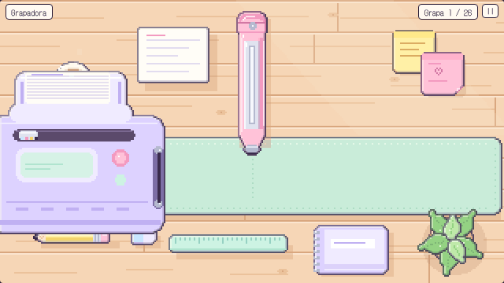
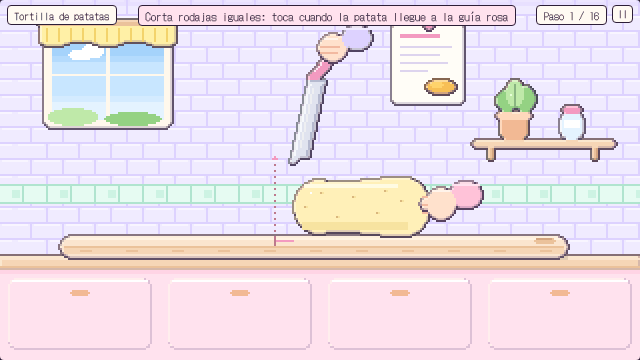

# 🌸 Clic Clac 🌸

**Minijuegos cozy de un solo botón, en pixel art pastel.**
Trabajos rutinarios, pero bonitos: llenar botellas, grapar folios, tostar pan, hacer una tortilla, revelar fotos…
Todo se juega con **un solo botón** y cuenta la precisión hasta la nota **S+**.

### [▶ Jugar ahora en el navegador](https://adry2342.github.io/Clic-Clac/)

*Funciona en PC y en móvil. Sin instalar nada.*

---

## 🎮 Los minijuegos

Cada juego tiene **varias fases** y cada fase cambia el ritmo: unas piden un clic perfecto, otras mantener y soltar, otras aguantar el pulso.

<table>
<tr>
<td width="50%" valign="top">

### 🍼 Botellas en la cinta

**Fase 1 · Llenar.** El grifo se abre solo: cierra cuando el líquido llegue a la línea rosa. Cada forma (refresco, garrafa, matraz…) se llena a su ritmo.
**Fase 2 · Tapones.** Las botellas vuelven y el tapón tarda en caer: suéltalo un pelín antes.

</td>
<td width="50%" valign="top">

### 📎 Grapadora

**Fase 1 · Grapar.** Los montones llegan por una cinta transportadora que pasa bajo la grapadora: grapa cada marca rosa justo debajo de la cabeza. Ningún montón es igual: grosor, una, dos o tres marcas en cualquier sitio, y la cinta acelera, frena o va a tirones.
**Fase 2 · Apilar.** Un compañero cruza de lado a lado en su silla de oficina con el montón en la cabeza (el pistón de gas sube con la torre): toca para soltarlo encima. Si la torre se inclina demasiado, gira entera, se cae y se acaba la fase.

</td>
</tr>
<tr>
<td valign="top">

### 🍞 Tostadora

**Fase 1 · Tostar.** Mantén para bajar la palanca y suelta en el color del pedido. La marca rosa de la aguja solo sale en la primera tostada: luego, a ojo.
**Fase 2 · Untar.** La espátula cruza una sola vez: mantén al entrar en la tostada y suelta al salir. Las guías solo salen en la primera pasada. Mantequilla, mermelada, crema de cacahuete, miel…

</td>
<td valign="top">

### 🥔 Tortilla de patatas

Pela la patata (gira sola: toca cuando una franja de piel pase por la línea del pelador), córtala a ojo en los trozos que pida la receta, de 3 a 6, lo más iguales posible (las marcas rosas solo salen la primera vez), casca los huevos con la fuerza justa, bate a ritmo sin salirte de la zona y dale la vuelta con el impulso exacto.

</td>
</tr>
<tr>
<td colspan="2" valign="top" align="center">

### 📷 Fotos a coches

**Fase 1 · Calle.** Cámara de carrete: haz la foto cuando el coche pase por el centro. El carrete es limitado, hay patitos, gatos y perros cruzando… y algún pájaro que se posa en el objetivo.
**Fase 2 · Cuarto oscuro.** Mece la cubeta: la foto sale del papel en blanco poco a poco. Suelta cuando se vea bien; si te pasas, se quema a manchas y se pierde. Cada foto se revela a su ritmo y solo la primera trae guía. Al tenderlas se enciende la luz y lucen como copias de verdad.
**Fase 3 · Tendedero.** Cuelga cada foto cuando pase justo bajo la pinza.

</td>
</tr>
</table>

---

## ⭐ Cómo se puntúa

| Nota | Cuándo |
|:---:|---|
| ★ **Perfecto** | Justo en el momento (unos 50 ms de margen) |
| **Bien** | Muy cerca |
| **Regular** | Cerca |
| ✕ **Fallo** | Lejos, o pulsar cuando no hay nada que hacer |

La nota **S+** solo se consigue con todo en *Perfecto*. Al fallar, el juego te dice si **te adelantaste** o **te pasaste**.

## 🕹️ Controles

Toca la pantalla, haz clic o pulsa cualquier tecla. Nada más. También funciona con mando.

---

## 🛠️ Para desarrolladores

El juego es un único `index.html`, sin dependencias ni instalación.

- `src/shell.html`: HTML y CSS de la interfaz.
- `src/game.js`: todo el juego (dibujo pixel a pixel en canvas, sonido y lógica).
- `./build.sh`: junta los dos en `index.html`.

Para probar en local, abre `index.html` en el navegador.

## Créditos

Idea, dirección y pruebas: **Adri** ([@adry2342](https://github.com/adry2342)).
